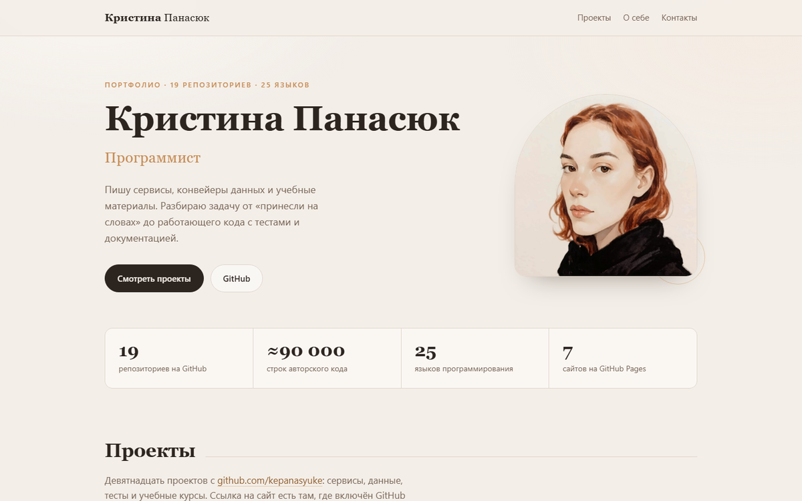

# Кристина Панасюк

**Сайт-портфолио:** [kepanasyuke.github.io/portfolio](https://kepanasyuke.github.io/portfolio/) — 28 проектов разом, около 205 тысяч строк кода: скриншоты, видео, фильтры по стеку.

**Python-инженер.** Пишу код с 2021 года: данные, автоматизация, локальные AI-системы.
Разбираю задачу от «принесли на словах» до работающего сервиса с тестами и документацией.

**Простыми словами:** я собираю работающие сервисы, могу сделать под них интерфейс. Здесь — примеры под разные
задачи: бэкенд на Python и PHP, мобильное приложение, разбор данных, автоматизация. У каждого проекта есть README,
где написано, что он делает, и как его запустить.

  
  
  
  
  
  
  
  
  
  
  

---

## Главные проекты

### [Mirro](https://github.com/kepanasyuke/Mirro-) — локальная система ответов на вопросы

Полностью локальная система без внешних зависимостей: OpenAI-совместимый HTTP-API,
собственный поиск по знаниям и движок рассуждений.

- Двухуровневый **дисковый RAG-индекс на 4,8 млн записей** + in-memory индекс по 2,8 млн примеров
- **TF-IDF, BM25, TextRank и перцептрон написаны с нуля** — без numpy и сторонних ML-библиотек
- Знаниевый граф: понятия как узлы, связи как рёбра, ассоциативный вывод по цепочкам
- OpenAI-совместимые эндпоинты `/v1/chat/completions`, `/v1/feedback`, `/v1/self-learn`
- Набор тестов на `unittest`, реестр функций в `CODE_MAP.md`, правила линтера в `LINTER.md`

`Python` · `RAG` · `NLP` · `HTTP API` · `unittest`

### [Search Service](https://github.com/kepanasyuke/something-else/tree/main/search-service) — асинхронный полнотекстовый поиск

Проект из репозитория [`something-else`](https://github.com/kepanasyuke/something-else).
Документы живут в **SQLite**, поиск идёт через **Elasticsearch**, FastAPI связывает их и держит оба хранилища в согласованном состоянии.

- Асинхронная работа с базой и индексом (`aiosqlite`), анализатор `russian` в Elasticsearch
- Автозагрузка CSV при старте, пагинация, подсветка найденных слов, экспорт в **XLSX**
- REST API с OpenAPI (`/search`, `/documents/{id}`, `/health`) и веб-интерфейс
- **Docker + docker-compose**: весь стек поднимается одной командой, настройки в `.env`
- **87% покрытие тестами** (pytest + coverage), `make lint`, `format`, `audit`, `test-coverage`
- Правила кода: функции до 30–50 строк, одна точка выхода, без `break`/`continue`

`Python` · `FastAPI` · `Elasticsearch` · `SQLite` · `Docker` · `pytest`

### [biz-analytics-portfolio](https://github.com/kepanasyuke/biz-analytics-portfolio) — шесть аналитических дашбордов

Шесть самостоятельных приложений «бэкенд + фронтенд» на одну тему — бизнес-аналитика: продажи, склад, финансы,
воронка продаж, отток клиентов и цены. Данные в SQLite, аналитика считается SQL, интерфейс — React и TypeScript
в стиле бренд-гайда Циан.

- **Шесть сервисов с одним контрактом:** каждый отдаёт `GET /api/dashboard` и раздаёт собранный фронтенд на `/`
- Цифры в заголовках **считаются из данных**, а не вписаны руками: план и факт, LTV и средний срок жизни клиента,
  эластичность спроса через **лог-лог регрессию**, когортное удержание M0–M5
- Правила кода **проверяются, а не декларируются**: один `return` последним оператором, 1–2 оператора в функции,
  без `while`/`break`/`continue` — собственный ESLint-плагин, Ruff (`max-returns = 1`, `max-statements = 2`)
  и AST-чекер на Python
- Дизайн-система отдельным пакетом: токены, hero с нумерованными показателями, SVG-графики без chart-библиотек
- Шесть скриншотов сняты headless-браузером с запущенных сервисов и лежат в `docs/screens/`

`Python` · `FastAPI` · `SQLite` · `SQL` · `React` · `TypeScript` · `Vite` · `ESLint` · `Ruff`

### [bug_python](https://github.com/kepanasyuke/fumiklea/tree/main/bug_python) — ретро-игра про первый баг

Сентябрь 1947 года, Гарвард, вычислительная машина Mark II: в реле №70 находят моль — тот самый
«first actual case of bug being found». Игрок вынимает насекомое латунным пинцетом и переносит
его в журнал отчёта, после чего видит историческую запись.

- Симуляция ЭЛТ-монитора на **pygame**: скан-линии, фосфорное послесвечение, виньетка, глитчи
- Живая моль внутри реле, журнал 1947 года с эффектом печатной машинки
- Звуки реле, пинцета и старого принтера
- `Makefile` с `install-system`, `install-venv`, `install-x11`, `play`

`Python` · `pygame` · `история вычислений`

---

## Остальные репозитории и что внутри

### [ml-portfolio](https://github.com/kepanasyuke/ml-portfolio) — ML-портфолио на семь разделов
Семь проектов под вакансию «Инженер ML (Uplift-моделирование)»: uplift-моделирование промокодов,
промо-экономика, A/B-тесты, пайплайны, клиентская ценность, мониторинг и SQL-аналитика. У каждого — бэкенд
на FastAPI, ML-логика и дашборд; живой кабинет собран статически и лежит на GitHub Pages.

`Python` · `FastAPI` · `pandas` · `scikit-learn` · `Jinja2` · `GitHub Pages`

### [f6-portfolio](https://github.com/kepanasyuke/f6-portfolio) — стенд Threat Intelligence
Восемь сервисов под задачи команды Threat Intelligence и два приложения поверх них: портал-обозреватель
баз и консоль, которая собирает бизнес-разделы через API сервисов. Бэкенды на FastAPI, фронтенды без сборки,
тесты и собственные данные.

`Python` · `FastAPI` · `SQLite` · `PostgreSQL` · `SQL`

### [support-desk](https://github.com/kepanasyuke/support-desk) — восемь модулей клиентской поддержки
Стек вакансии: PHP 8.3 и Yii2 REST на бэкенде, React 18 с TypeScript и Vite на фронтенде, AI-функции
в бэкенде, общий дизайн-стиль и оконная оболочка на Electron. Экраны сняты Playwright с работающих сервисов.

`PHP` · `Yii2` · `React` · `TypeScript` · `Electron` · `Playwright`

### [abs-migration](https://github.com/kepanasyuke/abs-migration) — АРМ системного аналитика для миграции АБС
Перевод данных из legacy-АБС в ЦФТ-Банк: карта данных, качество, сверка остатков, правила трансформации,
проводки, cut-over, ассистент по регламентам. Оконный интерфейс, микросервисный бэкенд на FastAPI, SQLite,
`2 102` теста.

`Python` · `FastAPI` · `SQLite` · `pytest` · `банковские данные`

### [onec-portfolio](https://github.com/kepanasyuke/onec-portfolio) — интерфейс 1С в браузере
Веб-приложение в стиле клиента 1С:Предприятие 8.3 («Такси»): восемь разделов под вакансию программиста 1С —
заказы и резервы в УТ, ОСВ с проверкой сальдо в БП, ЗУП, документооборот, карты, XML/SOAP, расширения
и планы запросов на MS SQL.

`1С` · `УТ 11.5` · `БП 3.0` · `XML/SOAP` · `MS SQL`

### [lada-cifra-content-analytics](https://github.com/kepanasyuke/lada-cifra-content-analytics) — пять сервисов контент-аналитики
Каталог, качество контента, тренды, товарная матрица и прогноз спроса. Бэкенд, интерфейс в визуальном языке
сайта LADA Цифра, тесты, запуск одной командой.

`Python` · `FastAPI` · `SQL` · `аналитика контента`

### [de-portfolio](https://github.com/kepanasyuke/de-portfolio) — инженерия данных
Batch-хранилище на Airflow и Spark, потоковая обработка на Kafka, движок качества данных, витрины в ClickHouse,
паритет при миграции хранилища и игра про backpressure. `564` проходящих теста, у каждого проекта анимированная
схема и README с объяснением решений.

`Python` · `Airflow` · `Spark` · `Kafka` · `ClickHouse` · `DWH`

### [bioinformatics](https://github.com/kepanasyuke/bioinformatics) — пайплайны и воспроизводимость
Семь небольших проектов под вакансию отдела биоинформатики и системного анализа: пайплайны, их поддержка,
тестирование, воспроизводимость, экономия ресурсов и документация. Данные синтетические или публичные
(GIAB, 1000 Genomes), все отчёты генерируются скриптами.

`Python` · `пайплайны` · `pytest` · `HTML-отчёты`

### [terminal-analytics-portfolio](https://github.com/kepanasyuke/terminal-analytics-portfolio) — аналитика терминальной сети
Четыре проекта о данных POS-терминалов, киосков и банкоматов: сверка с процессингом, соблюдение SLA,
поиск аномалий до того, как они станут простоем, и разбор потока заявок поддержки.

`Python` · `SQL` · `аналитика` · `SLA`

### [eight-projects](https://github.com/kepanasyuke/eight-projects) — восемь backend-проектов на Java
Java 17 и Spring Boot 3.3: REST-контракт, устранение N+1, границы транзакций, многопоточность, брокер
с outbox и DLQ, XML/XSD, подпись и сертификаты, WebSocket с машиной состояний. Плюс витрина с анимированным
SVG и игра «Логика».

`Java` · `Spring Boot` · `RabbitMQ` · `WebSocket` · `Maven`

### [moex-vibe-portfolio](https://github.com/kepanasyuke/moex-vibe-portfolio) — восемь full-stack проектов про биржу
React и TypeScript, REST, GraphQL и WebSocket, SSR, собственная дизайн-система и строгие правила линтера.

`React` · `TypeScript` · `GraphQL` · `SSR` · `Vite`

### [something-else](https://github.com/kepanasyuke/something-else)
Несколько независимых проектов в одной папке:

- **search-service** — асинхронный поисковый сервис на FastAPI, Elasticsearch и SQLite (описан выше)
- **VillaOenningerSimulator** — симулятор виллы с разрушением объектов в **Unity на C#**: менеджер разрушения дома, продвинутая камера, разрезание мешей, звук
- **fluid-materials-app** — визуализация материалов на **GLSL**: жидкость, гелий, газ
- **mercury-app** — шейдер ртути на **GLSL**
- **my-stratu-app** — приложение на **React + Vite** со сборкой в `dist`

`C#` · `Unity` · `GLSL` · `React` · `FastAPI`

### [fumiklea](https://github.com/kepanasyuke/fumiklea)
Мой первый репозиторий — двенадцать проектов папками, на четырёх языках. Здесь я училась
работать с тестами, линтерами и `Makefile`, а не «кодом в один файл».

**Python**
- `anime_parser_python` — парсер сайта с тестами и `flake8`, разделение на `src` и `tests`
- `banking_fraud_analytics_with_dataset_phyton` — аналитика банковских транзакций на датасете, фрод-аналитика
- `bug_python` — игра про историю первого бага: Гарвард 1947 года, моль в реле Mark II (описана выше)
- `calc_app_python` — веб-калькулятор на шаблонах и статике
- `currency_converter_python` — конвертер валют
- `christina_python` — игра-прототип по мотивам романа Стивена Кинга "Кристина"

**Java**
- `library_api_java` — API библиотеки: предметные сущности и связи между ними
- `tic_tac_toe_java` — крестики-нолики
- `tuhs_linux_animation_java` — анимация в терминале

**C и JavaScript**
- `decimal_C` — работа с десятичными числами на C
- `cosmos_play_js` — сцена на JavaScript, автотесты через **Playwright**

`Python` · `Java` · `C` · `JavaScript` · `flake8` · `Playwright` · `Makefile`

### [sysadmin-portfolio](https://github.com/kepanasyuke/sysadmin-portfolio)
Инфраструктура как код и автоматизация: курс, рабочие скрипты, плейбуки. Материалы на русском и английском.

`Ansible` · `Docker` · `PowerShell` · `Linux` · `MIT License`

### [projects-for-kids](https://github.com/kepanasyuke/projects-for-kids)
Проекты для школьной практики: сборка в Crazy Machines, ASCII-графика, задания для учеников.

`HTML` · `педагогика`

### [pixel-admin](https://github.com/kepanasyuke/pixel-admin)
Пиксельный платформер-квест по программам системного администратора. Запуск через PowerShell-скрипты.

`HTML` · `JavaScript` · `PowerShell`

### [informatics-site](https://github.com/kepanasyuke/informatics-site)
Онлайн-курс информатики для 3–11 классов и подготовки к ЕГЭ: уроки, презентации, игры «Собери код».
Внутри — свой сервер на Python (`server.py`, папка `_server`), материалы по классам, `sitemap.xml`.

`Python` · `HTML` · `педагогика`

### [cio-loyalty](https://github.com/kepanasyuke/cio-loyalty) — сервис лояльности на Laravel
Приложение, в котором клиенты брендов копят баллы и меняют их на награды, а бренд управляет каталогом в админке.
REST API на Laravel 12, журнал баллов с идемпотентностью, оплата пакетов через ЮKassa, Redis-кеш, очереди и 17 тестов.

`PHP` · `Laravel` · `MySQL` · `Redis` · `PHPUnit` · `OpenAPI`

### [robot-dispatch](https://github.com/kepanasyuke/robot-dispatch) — диспетчеризация парка роботов
Несколько сервисов на Python, из которых складывается одна система: задачи, телеметрия, мост к ROS2, мониторинг
и интеграция с WMS. Потерянные задачи возвращаются в очередь по lease, события идут через transactional outbox и RabbitMQ.

`Python` · `FastAPI` · `RabbitMQ` · `PostgreSQL` · `ROS2` · `gRPC`

### [fieldpulse](https://github.com/kepanasyuke/fieldpulse) — мобильное приложение выездного инженера
Flutter-приложение: заказы приходят по WebSocket, работают офлайн, наряд закрывается камерой, геолокацией и биометрией.
В репозитории — таблица соответствия требованиям вакансии и разбор архитектуры.

`Flutter` · `Dart` · `Bloc` · `Hive` · `Firebase` · `WebSocket`

### [sql](https://github.com/kepanasyuke/sql) — десять инструментов для работы с данными
Понять, откуда взялась цифра в отчёте, сверить источник и приёмник, разобрать логи, сравнить два SQL по скорости,
посмотреть, нет ли в файле персональных данных. Каждый проект запускается одной командой без установки.

`Python` · `SQL` · `PostgreSQL` · `ETL` · `observability`

### [data-reliability-dq](https://github.com/kepanasyuke/data-reliability-dq) — контроль качества хранилища
Контур проверок для аналитического хранилища: 12 SQL-проверок раз в полчаса, журнал инцидентов с приоритетами P1–P3
и SLA, метрики в Prometheus. Отвечает на вопрос «можно ли доверять этой витрине» до того, как это заметит аналитик.

`Python` · `SQL` · `Greenplum` · `Airflow` · `Prometheus`

### [digital-habits-qa](https://github.com/kepanasyuke/digital-habits-qa) — автотесты сервиса привычек
Учебный проект под вакансию тестировщика: сценарии на Gherkin, проверки API, базы и событий Kafka, отчёты Allure
и запуск в Jenkins. Плюс релизный процесс: ветки, теги, чек-лист.

`Java` · `Cucumber` · `Rest Assured` · `PostgreSQL` · `Kafka` · `Allure`

### [structured-programming-labs](https://github.com/kepanasyuke/structured-programming-labs) — 24 проекта по структурному программированию
Восемь программ на PHP, восемь на C# и восемь на C++ по жёстким правилам: одна точка выхода, без `break`/`continue`,
микрофункции, явная передача данных. Правила проверяются скриптом.

`PHP` · `C#` · `C++` · `статический анализ`

---

## Чем занимаюсь

| Направление | Что делаю |
|---|---|
| **Данные** | SQL (джойны, агрегации, CTE), PostgreSQL, обработка и нормализация выгрузок на Python, контроль качества данных |
| **Бэкенд** | HTTP-сервисы на Python и FastAPI; сервисы на Laravel (PHP) с админками и интеграциями платежей; тесты, документация |
| **Мобильная разработка** | Flutter и Dart: offline-first, WebSocket, Firebase, сборка под iOS и Android |
| **AI-системы** | Локальные RAG-системы, поиск по знаниям, OpenAI-совместимые API, знаниевые графы |
| **ML и моделирование** | Uplift-модели и промо-экономика, A/B-тесты, прогноз спроса и оттока, синтетические данные для проверки гипотез |
| **1С и выгрузки** | Демо-приложения в интерфейсе 1С:Предприятие 8.3 (УТ, БП, ЗУП); разбор выгрузок: ОСВ, карточки счетов, проверка сальдо |
| **Автоматизация** | Скрипты на Python и PowerShell, автоматическая отчётность, автотесты интерфейса |
| **Инфраструктура** | Docker, Ansible, развёртывание сервисов на Linux, Git |
| **Документация** | Техническая документация, по которой работает новый человек; ревью кода; наставничество |

## Образование

- НИУ ВШЭ — бизнес-информатика
- НИУ ВШЭ — прикладное искусство
- НГПУ — педагогическое образование

## Прикладное искусство

Второе высшее — НИУ ВШЭ, прикладное искусство. Оттуда привычка к композиции, цвету и постановке
кадра: те же навыки, что нужны в визуализации данных и интерфейсах. Несколько работ со съёмок.

<table>
  <tr>
    <td></td>
    <td></td>
    <td></td>
  </tr>
  <tr>
    <td></td>
    <td></td>
    <td></td>
  </tr>
  <tr>
    <td></td>
    <td></td>
    <td></td>
  </tr>
  <tr>
    <td></td>
    <td></td>
    <td></td>
  </tr>
</table>

## Связаться

Резюме: [cloud.mail.ru](https://cloud.mail.ru/public/ys9R/4Rk5TpzgL)

Открыта к предложениям: Python-разработка, аналитика и инженерия данных, автоматизация тестирования.
